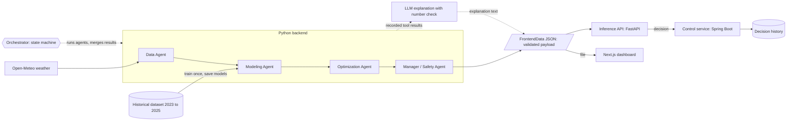

# Solar Farm AI Control System

[](https://github.com/khanhduynguyen2301-collab/solar-ai/actions/workflows/ci.yml)

**Live demo:** https://solar-ai-chi.vercel.app (open the Simulation page for the agents, their reasoning and the 3D farm)

A multi-agent system that decides, hour by hour, whether a row of solar panels
should rotate to a new tilt angle. It weighs the predicted energy gain against
the cost of moving, and a deterministic safety agent has the final word.

Built at a hackathon by a team of three: Luan (data pipeline), Duy (models, optimization, agents, backend), Tung (dashboard). The inference API, saved models, CI/CD, Docker image and Java control service were added afterwards by Duy in this repository, a fork of [the team's original](https://github.com/luanhoangle05/solar-ai).

> **This is a prototype simulation.** No hardware is controlled. Energy labels
> are physics-simulated, not measured production, and the movement and safety
> coefficients are assumptions, not calibrated values. Details are in
> [What is real and what is simulated](#what-is-real-and-what-is-simulated).

## Contents

- [Overall architecture](#overall-architecture)
- [System design](#system-design)
- [Actual results](#actual-results)
- [Testing](#testing)
- [Latency](#latency)
- [Run the demo](#run-the-demo)
- [What is real and what is simulated](#what-is-real-and-what-is-simulated)
- [Known gaps](#known-gaps)
- [Repository guide](#repository-guide)
- [Documentation](#documentation)

## Overall architecture



The agents can be run three ways, all producing the same payload: a script that writes a file, an HTTP API that serves it from saved models, and a Java control service that calls the API on demand or on a schedule and keeps the history.

The original system has three parts that meet at two contracts:

| Part | Owner | What it does |
| --- | --- | --- |
| Data pipeline (`src/pipeline/`) | Luan | Fetches and validates weather, adds sun position, builds the labeled dataset |
| Models, agents, backend (`src/models/`, `src/agents/`, `src/service/`) | Duy | Predicts energy, optimizes the angle, applies safety, produces one decision per run |
| Dashboard (`frontend/`) | Tung | Reads one validated payload and shows the decision, the agents and the farm |

- **Pipeline to backend:** rows with 13 fixed columns (weather, sun position, panel angle, energy label).
- **Backend to dashboard:** one `FrontendData` JSON object, written to a file or returned by the API. The backend validates it before writing, and the dashboard validates it again with a matching Zod schema before showing anything.

The dashboard is a static site: it reads the payload file at build time, so the deployed demo needs no server, database or API key. It does not call the API or the control service yet.

Two services were added on top:

| Service | What it does |
| --- | --- |
| Inference API (`src/api/`, Python) | Loads saved models at startup and returns a decision per request, so nothing is retrained |
| Control service (`control-service/`, Java) | Requests decisions from the API, stores every one, tracks the simulated row position, and can run hourly |

**Stack:** Python 3.11, PyTorch, XGBoost, FastAPI, pandas, pvlib · Java 21, Spring Boot, JPA, Flyway, PostgreSQL · Next.js, React, TypeScript, React Three Fiber, Zod · Anthropic API for explanations · GitHub Actions for CI · Vercel for the dashboard.

## System design

### The four agents

Each agent coordinates tools, records what they returned, and hands only its own section of the result to the next. The models and calculators are tools, not agents, and there is one set of agents per decision, not one per panel.

| Agent | Question it answers | Tools it coordinates |
| --- | --- | --- |
| Data | What is the weather for this hour, and can it be trusted? | Weather fetch (with retry and cache fallback), validation, solar position, feature building |
| Modeling | How much energy would the row produce at each candidate angle? | Model comparison, selection by lowest validation RMSE, energy prediction (LSTM, XGBoost) |
| Optimization | Which angle gives the best gain after paying for the movement? | Movement cost, net benefit, optimizer |
| Manager / Safety | Is it safe, and is it worth it? | Wind, angle-limit, data-freshness, panel-status and model checks, then the decision rule |

### Orchestrator

The orchestrator is a plain state machine, not an LLM. It runs the agents in order, merges each one's section into a shared state, and collects their logs. If a stage fails, the failure is recorded and the run still goes to the Manager, which holds or stows. A missing result is never filled in.

### Decision rule

Applied in this order, by code:

1. A severe safety violation (for example wind over the limit): **STOW**.
2. Stale or unreliable data, or any other failed check: **HOLD**.
3. Best net benefit at or below the threshold: **HOLD**.
4. Otherwise: **ROTATE** to the recommended angle.

### Cost model

Everything is in kWh-equivalent for one 20-panel row over one hour.

```text
movement_cost = degrees_moved × (0.002 motor + 0.001 wear)
energy_gain   = predicted_kWh(candidate angle) - predicted_kWh(current angle)
net_benefit   = energy_gain - movement_cost
```

Every candidate angle is scored this way, including staying put at zero cost. The highest net benefit wins; ties go to the least movement, then the lowest angle. The Manager only rotates when the net benefit is above 0.02. The coefficients are prototype assumptions in `src/common/config.py`, and there are no currency figures.

### Where the LLM is used

After an agent's tools have run, the agent asks an LLM to explain its recorded tool results in two or three sentences.

- **It only explains.** The decision is final before the LLM is asked.
- **Its text is checked.** An explanation containing any number that no tool produced is discarded.
- **It is optional.** Without an API key, or if the call fails, agents use templated text and the decision is identical.

### Design choices

| Choice | Why |
| --- | --- |
| Deterministic safety, LLM for wording only | A language model must not be able to override a wind limit or invent a figure |
| Chronological train / validation / test split | Random splits leak future weather into training and inflate accuracy |
| Model selection by a fixed rule | Lowest validation RMSE; the test year is never used to choose |
| Optimize net benefit, not raw energy | Chasing small gains wears out the tracker for nothing |
| One validated payload between backend and dashboard | The two halves can be built and tested independently |
| Unavailable results are null, never zero | A missing model or stage must not look like a real measurement |

More detail, including ownership and contract rules, is in [docs/architecture.md](docs/architecture.md).

## Actual results

Trained on 2023, validated on 2024, tested on 2025. Figures are computed, not estimated, and stored in [data/evaluation/system_evaluation.json](data/evaluation/system_evaluation.json).

**Model accuracy**

| Model | Validation RMSE (kWh) | Test RMSE (kWh) | Picks the best angle (test hours) |
| --- | --- | --- | --- |
| LSTM (PyTorch) | 0.0093 | 0.0101 | 96.4% |
| Boosting (XGBoost) | 0.0358 | 0.0321 | 75.6% |
| Linear regression | not available | not available | not available |
| Random forest | not available | not available | not available |

The two baseline models are not implemented yet, so they are reported as unavailable rather than estimated.

**One year of decisions** for one row, replaying every hour of 2025 against a row fixed at 35 degrees:

| | |
| --- | --- |
| Energy, fixed row | 14,327 kWh |
| Energy, agent-controlled row | 14,977 kWh |
| Movement cost | 8.7 kWh-equivalent |
| Net benefit | +641.5 kWh-equivalent (about 4.5%) |
| Decisions | 177 ROTATE, 8,542 HOLD, 24 STOW |
| Small moves avoided by the threshold | 416 |
| Unsafe rotations | 0 |

This replay scores the selected model's choices with that model's own predictions, so the gain is optimistic. It is not evidence of real-world savings.

**The run shown in the live demo** ([data/evaluation/demo_recommendation.json](data/evaluation/demo_recommendation.json)): the hour starting 2025-06-05 19:00 UTC, with the row at 60 degrees.

| Step | Result |
| --- | --- |
| Model selected | LSTM (validation RMSE 0.009265 kWh) |
| Prediction | 7.867 kWh at 30 degrees, 7.059 kWh at the current 60 degrees |
| Optimization | Gain 0.808 kWh, movement cost 0.090, net benefit +0.7182 kWh-equivalent |
| Safety | All six checks passed |
| Decision | ROTATE to 30 degrees (simulated) |

## Testing

Every pull request and every push to `main` runs both suites on GitHub Actions, plus a frontend type check, lint and production build, and then builds the two service images and runs them together over HTTP with a real PostgreSQL. Tests never call the LLM or the network.

**Delivery.** On a push to `main` or a version tag (`v*`), the images that passed those steps are published to the GitHub container registry as `ghcr.io/khanhduynguyen2301-collab/solar-ai` (Python API) and `ghcr.io/khanhduynguyen2301-collab/solar-ai-control-service` (Java control service), tagged `latest` (or the version) and `sha-<commit>`. Pull requests are tested but never published. A push to `main` then deploys the API image to Google Cloud Run at https://solar-ai-api-363580008545.us-central1.run.app (an API key is required; see [docs/operations.md](docs/operations.md#hosting-the-api-on-cloud-run)). The dashboard is deployed separately by Vercel on every push to `main`.

**Backend: 511 tests** (Python `unittest`)

| Area | Tests | What is checked |
| --- | --- | --- |
| Agents, orchestrator, LLM reasoning, live Data Agent | 128 | Tool coordination, the decision rule (STOW, HOLD, ROTATE), failure routing, and that the LLM cannot change a result |
| Models, evaluation, optimizer and saved models | 131 | Training smoke tests, no data leakage in LSTM sequences, metric math, model selection, net-benefit optimization, and that a loaded model predicts exactly as the trained one and a damaged file is refused |
| HTTP API | 48 | Valid payloads, strict input validation, the error envelope, the API key check, scenario and day listings, rate limits, starting without models, and the load-test arithmetic |
| Weather pipeline | 61 | Provider mapping, validation, transform, solar position |
| Dataset loading and example data | 59 | Delivered splits are never re-split, chronological order, labels never used as features |
| Database storage | 32 | PostgreSQL persistence; 23 of these skip when no database is running |
| Shared contracts | 30 | Every payload shape and its consistency rules |
| End-to-end slice | 22 | Data to trained model to agents to a validated dashboard payload |

**Frontend: 459 tests** (Vitest, 22 files): 396 logic and schema tests and 63 page and component render tests.

**Control service: 41 tests** (JUnit 5): the decision flow against a real database schema, the HTTP client against a local test server (request shape, status mapping, timeouts), the scheduler, and the error handling.

| Check | Where | Typical time |
| --- | --- | --- |
| Backend test suite | CI | 60 to 120 s including dependency install |
| Frontend type check, lint, tests, build | CI | 50 to 90 s |
| Backend test suite | Laptop | about 25 s |

Not covered: browser interaction tests (dragging, 3D rendering) are manual, and there is no measured test-coverage percentage.

## Latency

Measured with `python -m scripts.benchmark_latency` and stored in [data/evaluation/latency.json](data/evaluation/latency.json). These are wall-clock timings on one laptop (16 logical CPUs, no GPU, full 2023 to 2025 dataset). They describe this prototype on that machine and are not a performance guarantee.

**Making one decision**, once the models are trained and scored:

| Step | Median | Repeats |
| --- | --- | --- |
| Whole decision, all four agents plus payload validation, no LLM | 7.4 ms | 30 |
| Modeling Agent stage (LSTM prediction for 7 candidate angles) | 0.8 ms | 30 |
| Optimization Agent stage | 0.24 ms | 30 |
| Manager / Safety Agent stage | 0.12 ms | 30 |
| LSTM prediction for 7 angles, on its own | 0.64 ms | 100 |
| Boosting prediction for 7 angles, on its own | 9.1 ms | 100 |

**The API under load.** 2,000 `POST /recommendations` requests per row (recorded mode, LSTM selected, no LLM), measured with `python -m scripts.load_test` and stored in [data/evaluation/load_test.json](data/evaluation/load_test.json) and [load_test_4_workers.json](data/evaluation/load_test_4_workers.json). No request failed.

| Server processes | Simultaneous clients | Requests per second | p50 | p95 | p99 |
| --- | --- | --- | --- | --- | --- |
| 1 | 1 | 42 | 23.6 ms | 25.4 ms | 28.8 ms |
| 1 | 4 | 59 | 67.0 ms | 88.9 ms | 109.1 ms |
| 1 | 16 | 59 | 274.6 ms | 329.2 ms | 401.0 ms |
| 1 | 32 | 59 | 535.0 ms | 661.4 ms | 745.5 ms |
| 4 | 1 | 44 | 22.5 ms | 24.8 ms | 26.5 ms |
| 4 | 4 | 94 | 34.8 ms | 47.7 ms | 66.9 ms |
| 4 | 16 | 127 | 98.6 ms | 205.1 ms | 274.8 ms |
| 4 | 32 | 156 | 190.0 ms | 244.1 ms | 284.5 ms |

What this shows: one process tops out near 59 requests per second however many clients connect, because the work is Python code that runs on one core at a time, so extra clients only queue. Four processes raise the ceiling to about 156 and cut the p99 at 32 clients from 746 ms to 285 ms. A request over HTTP takes about 23 ms against 7.4 ms in process; the difference is request parsing, building and validating the 50-row payload, and JSON encoding. The load generator ran on the same laptop and competed for its CPU, so these are not capacity figures.

**External calls**, which dominate when they are used:

| Step | Median | Range | Repeats |
| --- | --- | --- | --- |
| One LLM explanation (Claude Haiku 4.5) | 1.39 s | 1.26 to 2.46 s | 3 |
| One live weather request (Open-Meteo) | 0.68 s | 0.68 to 0.79 s | 3 |

A run with explanations makes one LLM call per agent, in sequence, so it takes a few seconds; the decision itself is ready in milliseconds and does not wait for the LLM.

**One-off setup**, done once by `scripts.train_models` and then saved:

| Step | Time |
| --- | --- |
| Train boosting (61,173 rows) | 18 s |
| Train LSTM | 97 s |
| Score all models on the 2024 validation year (61,376 rows) | 228 s |

The saved set is about 24 MB. The API loads it at startup and verifies a checksum for every file, so no request ever trains or re-scores a model.

**Live dashboard**, five requests per page from one location, HTML only:

| Page | Time to first byte | Full HTML | Size |
| --- | --- | --- | --- |
| Dashboard | 159 ms | 240 ms | 68 KB |
| Simulation | 143 ms | 230 ms | 67 KB |
| Farm | 154 ms | 267 ms | 143 KB |

The pages are static and served from Vercel's cache. Time for the browser to download and draw the 3D scene is not measured.

## Run the demo

### Option 1: open the live demo

https://solar-ai-chi.vercel.app. Nothing to install. It shows the recorded run above.

### Option 2: run the dashboard locally

Requires Node.js. From the repository root in PowerShell:

```powershell
cd frontend
npm install
npm run dev
```

Open http://localhost:3000. By default it shows the mock fixture. To show the same real run as the live demo, create `frontend/.env.local` containing:

```text
SOLAR_FRONTEND_DATA=data/evaluation/demo_recommendation.json
```

Then restart `npm run dev`.

### Option 3: generate a new agent run

Requires Python 3.11. From the repository root:

```powershell
py -3.11 -m venv .venv
.\.venv\Scripts\python.exe -m pip install -r requirements.txt

# A recorded daytime hour from the dataset (drop --skip-lstm to include the LSTM, which is much slower)
.\.venv\Scripts\python.exe -m scripts.run_recommendation --skip-lstm

# The current hour's live forecast for the demo site
.\.venv\Scripts\python.exe -m scripts.run_recommendation --live
```

The result is written to `data/evaluation/latest_recommendation.json`. Point `SOLAR_FRONTEND_DATA` at that file to see it in the dashboard.

| Option | Effect |
| --- | --- |
| `--angle 60` | Sets the row's current angle |
| `--skip-lstm` | Trains boosting only; the LSTM is reported unavailable |
| `--live` | Fetches the current forecast instead of replaying a dataset hour |
| `--no-llm` | Templated explanations only |
| `--output PATH` | Chooses the output file |

**LLM explanations** need an Anthropic API key in a `.env` file at the repository root (the file is git-ignored). Without it everything still runs:

```text
ANTHROPIC_API_KEY=sk-ant-...
```

**Dataset.** The full 2023 to 2025 dataset is not committed; see [docs/full-dataset.md](docs/full-dataset.md). Without it, the committed seasonal sample is used, so your numbers will differ from the results above.

### Option 4: run the API

Train and save the models once, then serve decisions without retraining:

```powershell
.\.venv\Scripts\python.exe -m scripts.train_models
.\.venv\Scripts\python.exe -m uvicorn src.api.app:app --port 8000
```

Interactive documentation is at http://localhost:8000/docs.

| Endpoint | Purpose |
| --- | --- |
| `GET /health` | The process is up |
| `GET /ready` | Models are loaded (503 until they are) |
| `GET /models` | The saved models, their validation metrics and the selected one |
| `GET /hours` | The recorded hours that can be replayed |
| `POST /recommendations` | One decision, as the same `FrontendData` the dashboard reads |

```powershell
curl.exe -X POST http://localhost:8000/recommendations -H "content-type: application/json" -d '{\"current_angle_deg\": 60}'
```

Request fields, all optional: `mode` (`recorded` or `live`), `timestamp` (a recorded hour from `/hours`), `current_angle_deg` (0 to 90, default 35) and `explain` (add LLM explanations; slower and needs an API key on the server).

- **Errors** use one shape, `{"error": {"code", "message"}}`, and never include internals.
- **Rate limits** are per client address: 120 requests a minute, and 6 a minute for `live` or `explain` requests, which call outside services. Change them with `SOLAR_API_RATE_LIMIT_PER_MINUTE` and `SOLAR_API_EXTERNAL_RATE_LIMIT_PER_MINUTE` (0 turns a limit off).
- **Browser access** is allowed from `http://localhost:3000` only; set `SOLAR_API_CORS_ORIGINS` to change it.
- **Authentication** is one shared key, off by default. Set `SOLAR_API_KEY` on the server and callers must send it in an `X-API-Key` header; `/health` and `/ready` stay open. Set it before exposing the API publicly.

### Option 5: run the API with Docker

No Python setup needed. Run the image CI publishes from `main`:

```powershell
docker run --rm -p 8000:8000 ghcr.io/khanhduynguyen2301-collab/solar-ai:latest
```

Or build it yourself from the repository root:

```powershell
docker build -t solar-ai-backend .
docker run --rm -p 8000:8000 solar-ai-backend
```

The API is then at http://localhost:8000. The image trains its models at build time on the committed seasonal sample, so it starts ready. It contains no API key and not the full dataset.

| To | Do |
| --- | --- |
| Get LLM explanations | Add `-e ANTHROPIC_API_KEY=sk-ant-...` before the image name |
| Serve models trained on the full dataset | Train them locally, then add `-v "${PWD}/models/artifacts:/app/models/artifacts:ro"` and mount the dataset with `-v "<path to gem_2023_2025>:/app/data/generated/gem_2023_2025:ro"` |
| Write one recommendation file instead of serving | `docker run --rm -v "${PWD}/out:/out" solar-ai-backend python -m scripts.run_recommendation --skip-lstm --output /out/recommendation.json` |

### Option 6: run the control service (Java)

A Spring Boot service that sits in front of the Python API. It decides nothing itself: it asks the Python API for decisions, stores every one, and tracks the simulated position of the controlled row so each request starts where the last one left it.

Start the Python API first (Option 4), then from `control-service/`:

```powershell
.\mvnw.cmd spring-boot:run "-Dspring-boot.run.profiles=local"
```

The `local` profile uses a file database, so nothing else needs installing. Without it the service expects PostgreSQL (`SOLAR_DB_URL`, `SOLAR_DB_USER`, `SOLAR_DB_PASSWORD`). It listens on http://localhost:8080.

| Endpoint | Purpose |
| --- | --- |
| `POST /api/decisions` | Request a decision and store it. With no `currentAngleDeg` it starts from the simulated row position and then updates it; with one it is a what-if question that leaves the row alone |
| `GET /api/decisions` | History, newest first; filter by `action`, `from`, `to`; page with `page` and `size` |
| `GET /api/decisions/{id}` and `/payload` | One stored decision, and the full payload the Python API returned |
| `GET /api/decisions/latest/payload` | The newest payload, in the format the dashboard reads |
| `GET /api/stats` | Counts by action and the summed reported net benefit of applied rotations |
| `GET /api/row` | The simulated row position |

It is also published as a Docker image, `ghcr.io/khanhduynguyen2301-collab/solar-ai-control-service`; [docs/control-service.md](docs/control-service.md#run-it-with-docker) has the run command.

Set `SOLAR_SCHEDULE_ENABLED=true` to have it request a decision every hour (`SOLAR_SCHEDULE_CRON`, `SOLAR_SCHEDULE_MODE`). The row position is simulated: no hardware reports it, and the stored net benefit is the model's prediction, not measured energy.

### Run the tests

```powershell
.\.venv\Scripts\python.exe -m unittest discover -s tests

cd frontend
npm test

cd ..\control-service
.\mvnw.cmd test
```

## What is real and what is simulated

| Part | Status |
| --- | --- |
| Weather in the dataset | Real archived forecast weather (Open-Meteo) |
| Energy labels | Physics-simulated with pvlib for a reference row, not measured |
| Model metrics | Computed on held-out data; they measure agreement with that simulation |
| Movement cost and safety limits | Prototype assumptions in `src/common/config.py` |
| Live weather run | Real fetch. The provider gives no forecast issue time, so freshness cannot be established and the Manager always holds |
| Recorded-hour run | A past dataset hour replayed as the forecast, reported as DEGRADED |
| Farm snapshot in a generated run | Simulated: every row shown READY at the control row's angle |
| Control commands | Simulation only; nothing is sent to hardware |
| Row-to-row shading | Not modeled; a decision is computed for one control row per run |
| 3D sun, clouds, sun-tracking demo and Sun lab in the dashboard | Illustrative only; they do not come from the model |

## Known gaps

- The Data Agent in `src/agents/data_agent.py` is still a scaffold. Runs use an
  interim live agent in `src/service/live_data_agent.py` built on the pipeline tools.
- Linear regression and random forest are not implemented.
- The LSTM is not used in a live run because it needs look-back weather history.
- The control service stores decision history, but the dashboard does not read it yet; its history list is still empty for generated runs.
- The control service has no authentication on its own endpoints, is not hosted, and serializes applied decisions in memory, so it must run as a single instance.
- The API's authentication is a single shared key (no per-user keys, expiry or revocation), and the hosted copy serves models trained on the seasonal sample; the live demo is still a static site showing one recorded run and does not call it.
- The API's rate limiter is in memory per process, so with several worker processes each one counts separately.

## Repository guide

| Path | Contents |
| --- | --- |
| `src/pipeline/` | Weather client, validation, solar position, storage |
| `src/models/` | XGBoost and LSTM models, evaluation, cost simulation, optimizer |
| `src/agents/` | The agents, orchestrator, trace recording and LLM reasoning |
| `src/service/` | Recommendation service and the interim live Data Agent |
| `src/api/` | HTTP API, request limits and the inference service |
| `control-service/` | Java (Spring Boot) service: decision history, scheduling and the simulated row position |
| `src/common/` | Shared contracts, schema and configuration |
| `frontend/` | Next.js dashboard |
| `scripts/` | Training, run, evaluation, benchmark, load-test and data-building commands |
| `tests/` | Backend test suite |
| `.github/workflows/ci.yml` | CI and delivery: backend, frontend and Java tests, then both service images built, run together and published |
| `Dockerfile` | Backend image that serves the API |
| `deploy/` | One-time Google Cloud setup for hosting the API on Cloud Run |
| `docs/` | Reference documentation; start at `docs/README.md` |

## Documentation

| Document | What it covers |
| --- | --- |
| [docs/api.md](docs/api.md) | The inference API: endpoints, request and response shapes, errors, rate limits, settings |
| [docs/control-service.md](docs/control-service.md) | The Java control service: what it stores, the simulated row position, endpoints, scheduler |
| [docs/operations.md](docs/operations.md) | Training and saving models, CI and delivery, the Docker image, every environment variable |
| [docs/README.md](docs/README.md) | Index of all documents, including the data pipeline and the original contract proposal |
